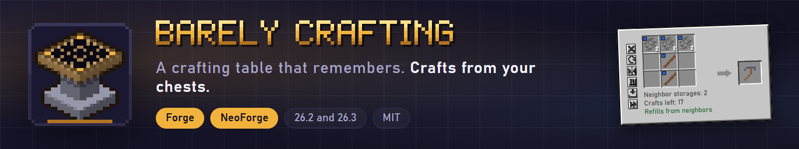

**A crafting table that remembers. Its 3x3 grid stays in the block and it crafts from the chests next to it.**

Barely Crafting adds the Crafting Station for Forge and NeoForge on Minecraft 26.2 and 26.3. Put a chest beside it, put one of each ingredient in the grid, and shift-click the result: the grid refills itself from the chest until the chest is empty. Wiki: https://itmecasey.com/wiki/barelycrafting/

- The grid keeps its items when you close the screen.
- Crafts from chests, barrels and any storage block with an item handler, on all six sides, nearest first.
- Server-side crafting: nothing is created or lost, leftovers like empty buckets are handled, and shift-click crafts as many as fit.
- Six buttons left of the grid: Clear, Rotate, Mirror, Balance, Refill and Craft All, with tooltips. Each can be switched off in the config.
- The screen shows how many storages it found, how many crafts are left and where the next ingredient comes from.
- BEI: the plus button of a recipe fills the grid.

**Does it pull items like a hopper?** No. It only takes an item for a craft or a button you press.

**Which versions?** Minecraft 26.2 and 26.3, Forge and NeoForge, one jar each. No Fabric, no older versions.

Source: https://github.com/ItMeCasey/BarelyCrafting (MIT)
